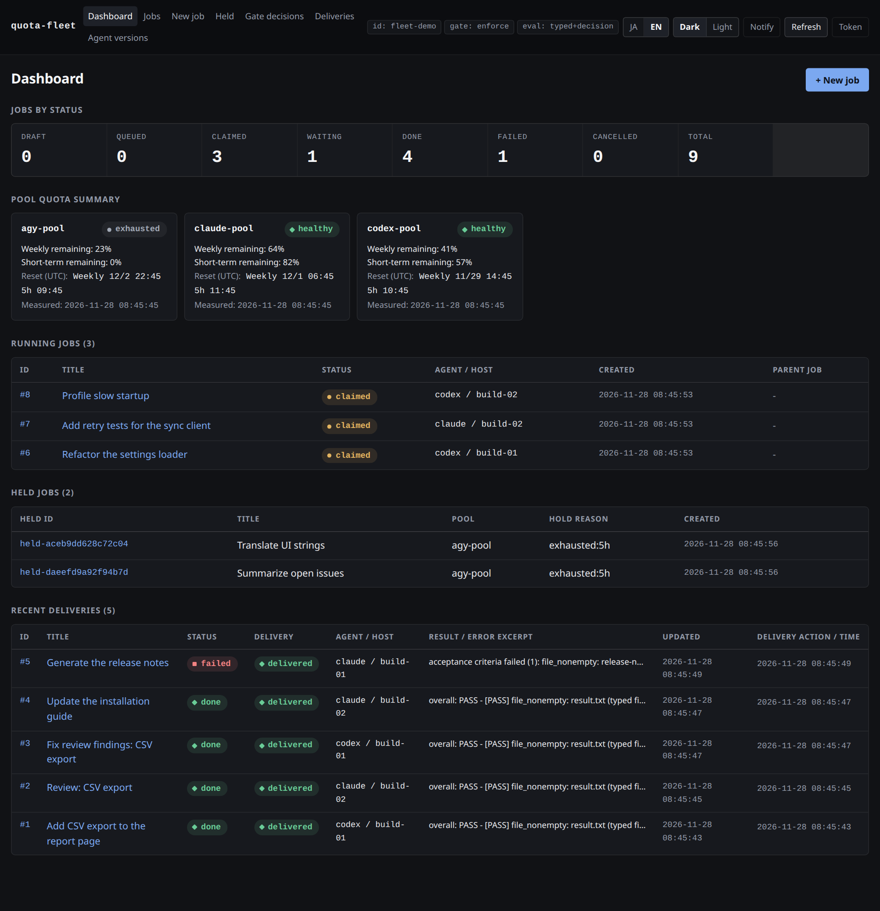
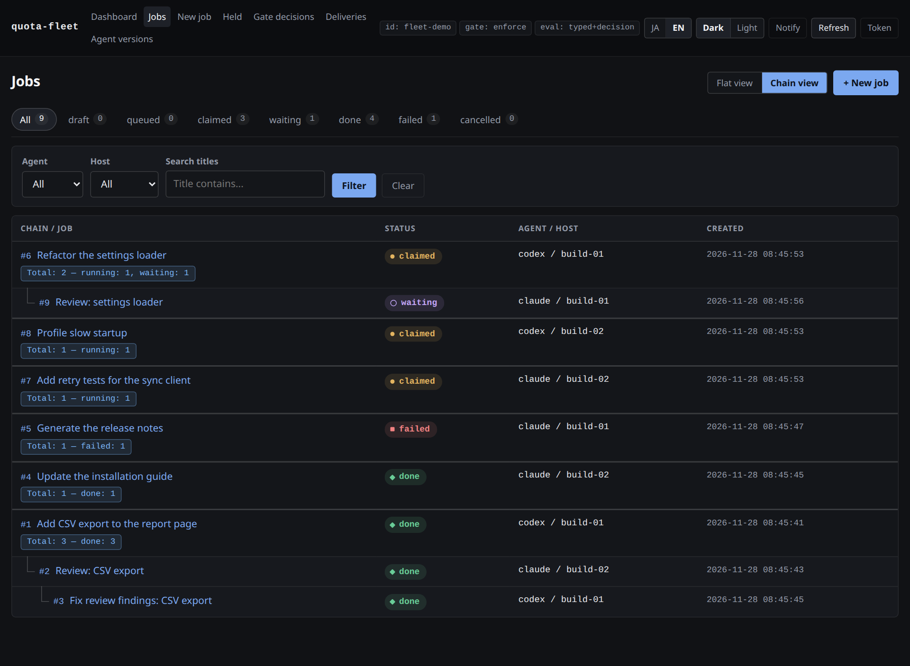
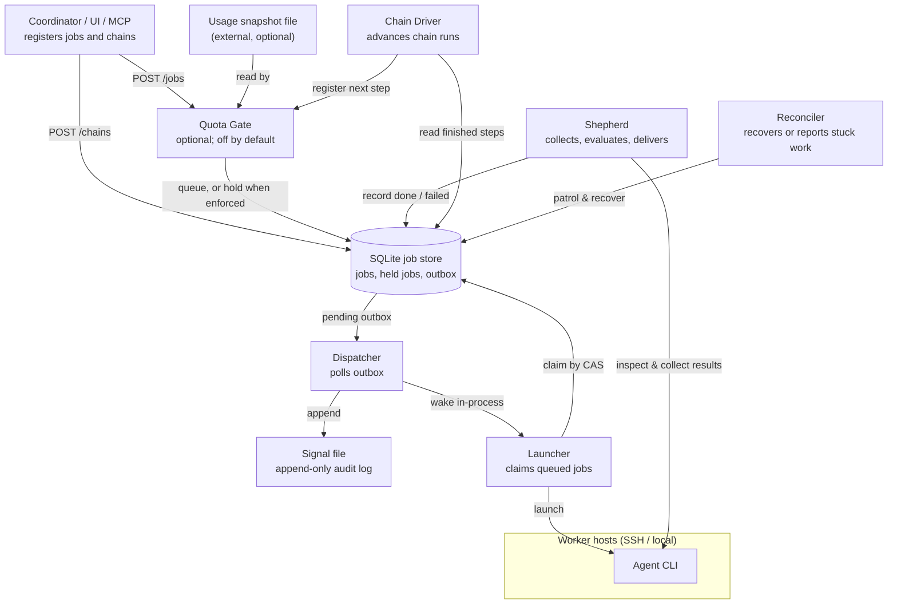

# quota-fleet

quota-fleet is a Go program that queues jobs for **coding-agent CLIs** (such as
Claude Code and Codex) on machines you own, launches them, checks finished jobs
against their acceptance criteria, and can hold new jobs while a **flat-rate
subscription quota** pool is measured as exhausted.

This repository holds the implementation and its design documents, including the
operating rules for an implement → review → fix pipeline.



<sub>The real web UI of a local `quota-fleet serve`, filled with sample data:
`runtime.adapter: mock` (no agent is launched), made-up jobs and hosts, and a
synthetic usage snapshot.</sub>

<details>
<summary>Jobs page, chain view (same sample data)</summary>



</details>

## How it fits together



`quota-fleet serve` runs the HTTP API, Quota Gate, Dispatcher, Launcher,
Shepherd, Chain Driver, and Reconciler in one process. The Quota Gate is off by
default and holds jobs only with `gate_mode: enforce` (using an external usage
snapshot and/or [reactive cooldown](docs/03-quota-gate.md#reactive-pool-cooldown));
the local CLI `quota-fleet job create` writes directly to the SQLite store and
bypasses the gate. For the conceptual architecture and how the current binary
differs from it, see
[docs/01](docs/01-architecture.md#differences-in-the-current-implementation)
(and [docs/06](docs/06-implementation-design.md) for the implementation
design).

## Case study

The design was extracted from a private deployment that develops
[clipboard-translator](https://github.com/ypsilonmeister/clipboard-translator)
and shipped its v0.11.0 release. These facts describe that deployment, which
preceded the Go implementation here ([full case study](docs/05-case-study.md)):

- Between 17 and 19 November 2026, the pipeline processed more than 60 pull
  requests for that repository. Each was implemented by one agent family,
  reviewed by another, and merged, or not, by the maintainer.
- In one night, two chains lost their gate jobs when a provider's short quota
  window emptied. The coordinator moved the remaining links to a different agent
  family instead of restarting the tickets. This incident is why the Quota Gate
  holds jobs instead of letting them fail.
- The maintainer's hands-on work in that release cycle was choosing an icon, one
  manual verification on a real device, confirming two semantic decisions on pull
  requests, merging, and giving the release go.

## Status

> Status: **active implementation**.
>
> Implemented:
>
> - **Core runtime** ([docs/06](docs/06-implementation-design.md)): SQLite job
>   store, HTTP API, Dispatcher/Launcher/Shepherd/Reconciler, SSH/local
>   adapter, Quota Gate (hold/release and
>   [reactive cooldown](docs/03-quota-gate.md#reactive-pool-cooldown)),
>   acceptance Evaluator, and file/webhook Notifier (code implemented;
>   production cut-over criteria in docs/06 are tracked separately).
> - **Embedded web UI** at `/ui/` ([docs/07](docs/07-ui-and-mcp.md)): model
>   pick list and automatic pool derivation ([docs/11](docs/11-ui-models.md)).
> - **MCP server**: stdio (`quota-fleet mcp`, [docs/07](docs/07-ui-and-mcp.md))
>   and Streamable HTTP (`/mcp`, [docs/13](docs/13-mcp-http.md); enable with
>   `api.mcp_http: true`).
> - **Scoped API tokens** (`api.tokens`, [docs/12](docs/12-api-tokens.md)).
> - **Usage snapshot Schema v1** and `quota-fleet usage validate`
>   ([docs/23](docs/23-usage-snapshot.md); enabled with `quota.usage_format: v1`,
>   default `legacy`).
> - **Selector** ([docs/19](docs/19-selector.md);
>   `selector.mode: off | record | apply`, default `off`): fills unspecified
>   agent, model, and pool fields from role, weight, and quota health without
>   overriding explicit values.
> - **Self-driving chain runs** (Chain Driver, [docs/22](docs/22-chain-runs.md)):
>   `POST /chains` or `quota-fleet chain create` advances implement → review →
>   fix rounds automatically and publishes only on a valid `ok_to_merge`
>   verdict.
> - **Review gate** ([docs/18](docs/18-review-gate.md); opt-in via
>   `review_gate.enabled: true`): `POST /decision/review-verdict` calls Google's
>   Gemini Decision API (`gemini-decision-1`) to judge a review report as
>   `ok_to_merge` or `changes_needed` (requires an API key and an
>   `operate`-scoped token).
> - **Per-job reasoning effort** ([docs/21](docs/21-job-effort.md)): optional
>   `effort` (`low` | `medium` | `high` | `xhigh`) on `POST /jobs` and MCP
>   `create_job` for `codex` and `claude` jobs.
> - **Agent version inventory** (`quota-fleet agents`,
>   [docs/08](docs/08-agent-versions.md)): probes versions across hosts with
>   drift detection (no automatic updates).
> - **Browser notifications** ([docs/14](docs/14-job-notifications.md)): live
>   job-completion alerts while the UI is open (`api.job_events: true`).
> - **Installable web UI (PWA)** ([docs/15](docs/15-pwa.md)): offline app shell
>   (requires HTTPS or localhost).
> - **Japanese and English web UI** ([docs/17](docs/17-i18n.md)): follows
>   browser language or user choice (CLI, API errors, and docs stay
>   untranslated).
> - **Web Push** ([docs/16](docs/16-web-push.md)): job-completion push alerts
>   with no UI tab open (`api.web_push: true`; HTTPS or localhost; iOS/iPadOS
>   16.4+ requires Home Screen installation).
>
> Not yet implemented:
>
> - Selector stage S3, assigning agents across a whole chain
>   ([docs/10](docs/10-selector.md), [docs/19](docs/19-selector.md)).
> - Chain Driver follow-ups: session resume, MCP tools, UI view for chain runs,
>   and Web Push for chain notifications ([docs/22](docs/22-chain-runs.md)).
> - Superseding held jobs (docs/20): not implemented on `main`; tracked in the
>   unmerged [PR #24](https://github.com/ypsilonmeister/quota-fleet/pull/24).
> - Burn-down research jobs ([docs/03](docs/03-quota-gate.md)): design only.

## Quickstart

1. **Get the binary** (single static Go binary, `CGO_ENABLED=0`):
   ```bash
   CGO_ENABLED=0 go build -o quota-fleet ./cmd/quota-fleet
   ```
2. **Initialize and start the server**:
   ```bash
   ./quota-fleet init
   ```
   `quota-fleet init` writes a minimal `fleet.yaml` (mode `0600`) with a
   generated `instance_id`, API authentication enabled, and two named bearer
   tokens in `api.tokens` ([docs/12](docs/12-api-tokens.md)). Each token value
   is generated independently and written only to the config file.

   - `coordinator` has every scope (`read`, `register`, `operate`, `worker`,
     and `agents`).
   - `watch` has only the `read` scope.

   Existing configurations with a single `api.token` are still accepted.

   Then start the server:
   ```bash
   ./quota-fleet serve
   ```
   `quota-fleet serve` prints a startup banner showing the active adapter, gate
   mode, evaluator mode, notifier, API auth status, and UI URL.
3. **Register your first job in the UI**:
   Open the UI URL shown in the startup banner (default
   `http://127.0.0.1:8737/ui/`), enter a named token from `api.tokens` (it needs
   `read` to view and `register` to create jobs), and create a job from the
   new-job form. You can also register jobs with the HTTP API or the CLI
   (`./quota-fleet job create --title "..."`). The CLI writes to the local store
   directly, so the Quota Gate and the Selector do not apply to it.
   To generate MCP client config snippets for AI clients, run
   `./quota-fleet mcp config`. The stdio snippets invoke `quota-fleet` by name,
   so to use them as generated, put the binary on the MCP client's `PATH`.
   Otherwise, pass its absolute path:
   ```bash
   ./quota-fleet mcp config --binary "$PWD/quota-fleet"
   ```
   The snippets read the token from `QUOTA_FLEET_TOKEN`. For a client that only
   inspects and registers jobs, set it to a named token with the `read` and
   `register` scopes.
4. **Enable the Quota Gate (Optional)**:
   Choose between two paths — or combine them:

   ### Path A — Minimal setup: Reactive Cooldown (no external collector)

   If you do not want to run a quota collector, enable
   [reactive pool cooldown](docs/03-quota-gate.md#reactive-pool-cooldown) and
   mark the pool `unmeasured: true`. When a failed agent run matches a quota or
   rate-limit error, `quota-fleet` pauses that pool with exponential backoff
   (holding new jobs or routing to an alternative pool, skipping queued jobs in
   the cooling pool, and running a single trial after expiry):

   ```yaml
   quota:
     gate_mode: enforce
     cooldown:
       enabled: true
       initial: 5m
       multiplier: 2.0
       max: 60m
       streak_reset_after: 2h
   pools:
     claude:
       unmeasured: true
       applies_to:
         - agent: claude
   ```

   Inspect or clear active cooldowns with:
   ```bash
   ./quota-fleet gate cooldowns
   ./quota-fleet gate cooldown clear claude
   ```
   See [docs/03-quota-gate.md#reactive-pool-cooldown](docs/03-quota-gate.md#reactive-pool-cooldown)
   for custom `rate_limit_patterns`, `rate_limit_exit_codes`, and per-pool
   overrides.

   ### Path B — Strict control: Schema v1 Snapshot (external collector)

   To hold jobs *before* a pool runs empty and release them automatically on
   measured recovery, supply a normalized JSON snapshot file (**Schema v1**,
   `schema_version: 1`) defined in
   [docs/23-usage-snapshot.md](docs/23-usage-snapshot.md). `quota-fleet` itself
   only reads and validates this file contract — it never stores or handles
   subscription credentials. (You can also enable reactive cooldown on measured
   pools; a newer healthy snapshot clears the cooldown immediately.)

   Minimal Schema v1 snapshot example:
   ```json
   {
     "schema_version": 1,
     "generated_at": "2026-11-26T20:30:12Z",
     "pools": {
       "demo-pool": {
         "status": "ok",
         "measured_at": "2026-11-26T20:30:10Z",
         "weekly": { "remaining_percent": 80, "reset_at": "2026-12-03T00:00:00Z" },
         "short":  { "remaining_percent": 60, "reset_at": "2026-11-27T01:30:00Z", "window": "5h" }
       }
     }
   }
   ```

   **Smoke-test with an arbitrary pool** (uncomment `pools:` and `quota:` in `fleet.yaml`, rename the pool `my-pool` to `demo-pool`, and keep `usage_format: "v1"` and `gate_mode: "dry-run"`):
   ```bash
   python3 examples/usage-generator/generate_sample.py \
     --pool demo-pool --weekly 80 --short 60 --out ./usage.json
   ./quota-fleet usage validate --file ./usage.json --config fleet.yaml --format v1
   ./quota-fleet gate check --config fleet.yaml --pool demo-pool
   ```
   > **Warning:** `examples/usage-generator/generate_sample.py` generates synthetic
   > data for **smoke-testing and configuration verification only**. Never use it
   > as operational input for `gate_mode: enforce`.

   **Connecting real collection & public scope**:
   - Deploy snapshots from your collector host using exclusive locking and
     generation protection (`flock` + `quota-fleet usage validate --format v1 --check-deploy --reject-older-than "$DEST"` + atomic `mv`; see [`examples/usage-generator/atomic_deploy.sh`](examples/usage-generator/atomic_deploy.sh) and [docs/23-usage-snapshot.md](docs/23-usage-snapshot.md)).
   - Reference collectors are not included yet. The Phase 2 plan for this public
     repository, deferred until needed, covers a generic runner and an official
     CLI-based Antigravity (`agy`) probe (which carries PTY/TUI parsing
     maintenance). Probes that rely on private APIs
     (such as Claude / Codex) are out of scope for this public repository;
     operators supply their own external measurement script writing Schema v1.
   - Before enabling `gate_mode: enforce`, measure end-to-end collect + sync
     latency over 24–48 hours to tune `quota.stale_after`, verify
     `quota-fleet usage validate --config fleet.yaml` exits `0`, and check
     failure diagnostics via `usage validate`, `gate check`, `gate held`, and
     `serve` logs (details in [docs/23-usage-snapshot.md](docs/23-usage-snapshot.md)).

## Supported OS boundaries (v1)

- **`quota-fleet serve` and local worker execution**: Linux (including Windows
  **WSL2**).
- **Native macOS / Windows**: CLI and MCP client connections to a remote
  `quota-fleet serve` instance only (native local `serve` is out of scope for v1).

## Why this exists

Hosted AI programmers charge per seat and per task. Meanwhile, most
developers already pay for flat-rate agent subscriptions (coding-agent CLIs
with weekly and rolling-window usage limits). Those limits are a *scheduling*
problem:

- A job sent to an exhausted pool fails, and the work is lost or must be
  babysat.
- A pool that resets with 40% left is money quietly evaporating.
- Several subscriptions, each with several model pools resetting at
  *different times*, cannot be juggled by a human.

This design treats subscription quotas as the compute substrate and builds
the missing control plane around them.

## The three pillars

1. **An asynchronous job substrate** ([architecture](docs/01-architecture.md),
   [job model](docs/02-job-model.md))
   Jobs live in a store that is the single source of truth. A signal file
   only *hints* that work exists; dispatchers, workers, a shepherd and a
   reconciler keep the queue moving even when individual pieces die, are
   duplicated, or lose messages. Claims are compare-and-swap; delivery is
   at-least-once; failed jobs are never retried automatically.

2. **Quota-aware scheduling** ([quota gate](docs/03-quota-gate.md))
   Before a job is queued, the gate checks *measured* remaining quota for
   the pool that would run it. Exhausted pools do not fail jobs — jobs are
   **held** and released automatically when measurement shows recovery.
   Assignment prefers the pool whose weekly window expires soonest, so
   capacity is spent before it resets. The design also lets leftover capacity
   near a reset be burned on pre-approved, read-only research jobs (not yet
   implemented).

3. **A verification pipeline** ([conventions](docs/04-pipeline-conventions.md))
   These are the pipeline's operating rules. Every ticket is meant to run
   implementation → independent review by a *different model family* → fixes
   by the *original implementer, resuming its session* → merge-ready, without
   returning to the human in between. Review findings must be reproduced
   before they are fixed. Judgment calls are parked on the pull request for
   merge time, not used as stop points. The human keeps exactly one job: the
   merge decision.
   The [Chain Driver](docs/22-chain-runs.md) automates the hand-offs: `serve`
   runs implement → review, branching on a verdict file written by the
   reviewer. A valid `ok_to_merge` leads to publish; `changes_needed` leads to
   fix → re-review. `max_rounds` caps the number of reviews (default 3), so
   there are at most `max_rounds - 1` fixes; if the last review still says
   `changes_needed`, the run stops with `max_rounds_exceeded` without
   publishing. A separate step budget, `max_steps = 2 × max_rounds + 1`, bounds
   the whole run. The driver also stops and reports when a step fails or the
   verdict is unusable. It does not yet resume the implementer's session, and
   it does not check that the reviewer is from a different model family; choose
   each step's agent accordingly.

## What this is not

- Not another coding agent. The workers are existing agent CLIs (Claude
  Code, Codex, Gemini-based agents, …) launched as ordinary processes on
  ordinary machines.
- Not a hosted service. The design assumes a small fleet of machines you
  own, and one coordinator.
- Not pay-as-you-go optimisation. If you run on metered API keys, you do
  not need the quota gate; the job substrate and the pipeline conventions
  still apply.

## Repository layout

- `cmd/quota-fleet/` — CLI entrypoint (`init`, `serve`, `job`, `gate`, `usage validate`, `agents`, `chain`, `mcp`, `mcp config`, `config check`, `status`)
- `examples/usage-generator/` — smoke-test Schema v1 snapshot generator (non-operational) and `flock` atomic deploy helper
- `internal/` — store, config, API server, runtime, SSH/local adapter, quota gate, Selector, admission (Selector → gate), chain definitions and branching, evaluator, web UI, MCP server, Web Push, agent version and model probes
- `docs/01-architecture.md` — components and how they interact
- `docs/02-job-model.md` — job states, claims, chains, failure semantics
- `docs/03-quota-gate.md` — pools, the hold/release gate, burn-down jobs
- `docs/04-pipeline-conventions.md` — the implement/review/fix pipeline rules
- `docs/05-case-study.md` — the system in production: a real OSS release
- `docs/06-implementation-design.md` — standalone implementation specification
- `docs/07-ui-and-mcp.md` — embedded UI and MCP design (v2)
- `docs/08-agent-versions.md` — agent version inventory and drift notification
- `docs/09-ui-redesign.md` — web UI visual redesign notes
- `docs/10-selector.md` — automatic model selection design (S1 / S2 implemented, see docs/19; S3 not yet)
- `docs/11-ui-models.md` — UI model selection and automatic pool derivation
- `docs/12-api-tokens.md` — API token scopes and audit
- `docs/13-mcp-http.md` — MCP over Streamable HTTP
- `docs/14-job-notifications.md` — job completion browser notifications (SSE)
- `docs/15-pwa.md` — installable web UI (manifest, icons, app shell cache)
- `docs/16-web-push.md` — Web Push on job completion (VAPID keys, setup, iOS limits)
- `docs/17-i18n.md` — web UI internationalization (dictionary, how to add strings)
- `docs/18-review-gate.md` — review gate (Gemini Decision API verdict endpoint) and how to roll it out
- `docs/19-selector.md` — Selector implementation (modes, selection table, records)
- `docs/20-held-supersede.md` — held-job supersede design, **not implemented** on `main` (the file arrives with the unmerged [PR #24](https://github.com/ypsilonmeister/quota-fleet/pull/24))
- `docs/21-job-effort.md` — per-job reasoning effort (`effort`: codex / claude)
- `docs/22-chain-runs.md` — self-driving chain runs
- `docs/23-usage-snapshot.md` — Schema v1 usage snapshot contract, validation CLI, and atomic deployment

## License

MIT — see [LICENSE](LICENSE).
