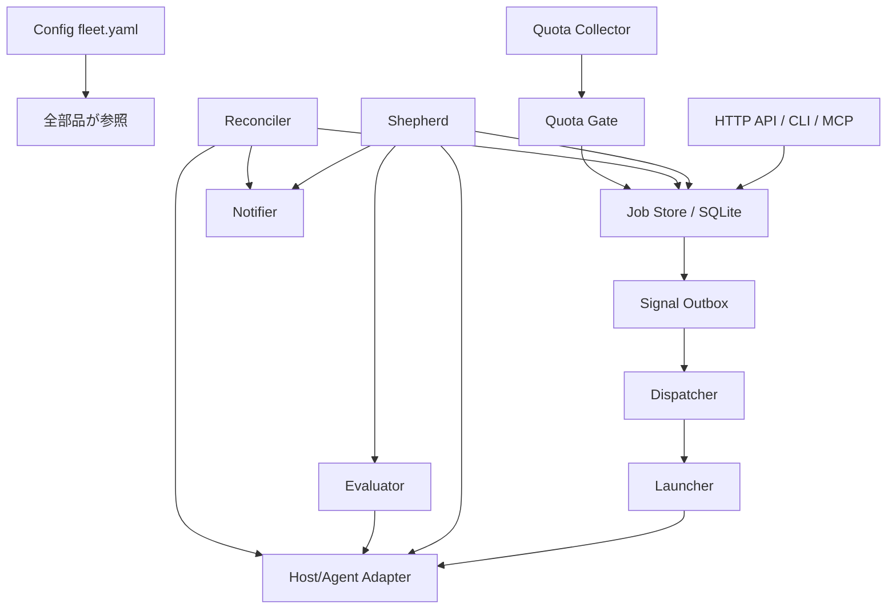

# 06 — 参照実装と自宅サーバー移行の設計（改訂ドラフト v2）

- 状態: **改訂ドラフト v2（2026-11-23、つむぎ作成）。かせ（別系統モデル）の独立レビュー（必須修正8件・推奨7件）を反映済み。採用判断はゆうや。**
- 改訂履歴: v1（2026-11-23 初版）→ v2（同日、レビュー反映。変更点の対応表は付録B）。
- 目的: 現行の Space「AIおてつだい便」＋フック＋cron で組んだジョブ基盤を、単独で動くオープンソース実装として切り出し、自宅 Ubuntu（常時稼働）で運用できる形にする。
- 動機: 現行の土台は約2時間で入れ替わる Muse の VM で、基盤としては脆い。加えて、現行の見回り役（Shepherd／Reconciler）は LLM エージェントの定時実行であり、キューが空でも枠を消費する（2026-11-23 に起床ゲートで応急対処済み）。決定論的コード化でこの2点を同時に解く。
- 材料: 本リポジトリの仕様（docs/01〜05）、現行実装の検証レポート（2026-11-22、かせ）、現行設計の正本（DESIGN.md、起床ゲート節を含む）、利用枠ゲート設計メモ、設計レビュー（2026-11-23、かせ）。
- 本書の範囲: 設計のみ。実装と現行システムへの変更は含まない。

## 0. 設計の前提と原則

現行仕様の原則はそのまま継承する。

- **ストアが正本、メッセージはヒント**。どの部品が落ちても、ストアを読み直せば収束する。
- **claim がロック**。全遷移は CAS（期待状態の一致を条件にした書き込み）＋ claim トークン照合。
- **at-least-once**。二重起床・二重納品は無害に倒す。
- **失敗ジョブの自動リトライなし**。attempts は claim 時に数え、上限に達したジョブは掃引から外れて報告される。
- **起動順は FIFO、同時実行上限は claimed 数**で数える。
- 新規の原則（現行の教訓から追加）:
  - **見回り・回収・ゲート判定は決定論的コード**にする。LLM が要るのは受け入れ条件の「意味的な評価」だけであり、それは Evaluator として隔離する（§1 部品11）。
  - **アイドル時に何も動かない**。ただし判定はファイルの有無ではなく **Store のアクティブ件数**で行う（§1.1）。LLM 評価器はジョブ終了時にだけ呼ぶ。
  - **個人値・環境固有値はコードに書かない**。すべて設定ファイルと Adapter の内側に閉じる。

## 1. 部品分解

| # | 部品 | 責務 | 境界（やらないこと） |
|---|---|---|---|
| 1 | **Config** | ホスト／エージェント／プール／閾値／パス／instance_id の定義を1ファイル（`fleet.yaml`）に集約し、全員へ配る | 実行時の動的変更はしない（再起動で反映） |
| 2 | **Job Store** | ジョブの正本。状態遷移（全 CAS）、`request_id` 冪等、親子の昇格・波及キャンセル、信号 emit の Outbox 記録、納品記録、リース・ゲート状態の永続化 | エージェントの起動・評価はしない |
| 3 | **Signal Dispatcher** | 信号（Outbox／JSONL）の配送、厳格パース、起床通知、heartbeat、信号ローテーション | ジョブの中身を読まない（ヒントだけ扱う） |
| 4 | **Host/Agent Adapter** | SSH／ローカル接続、workdir 用意、OS 別デタッチ起動、生存・終了判定、セッションID抽出、resume 起動 | ジョブの状態遷移はしない（Store 経由のみ） |
| 5 | **Launcher** | queued の最古を claim → **トークンを Store に永続化** → 仮リース設定 → Adapter で起動 → 仮リース解除、までを行って即終了 | 見回り・評価はしない（Q6(b) の分離を維持） |
| 6 | **Shepherd** | claimed ジョブの見回り、Evaluator の呼び出し、complete/fail、納品、空き枠の信号補充 | PR 作成・後続ジョブ登録はしない（Coordinator の責務。§7-3） |
| 7 | **Reconciler** | 信号ロスト復旧、停滞 claimed の検出、未納品回収、waiting 孤児検出、Dispatcher の heartbeat 監視（停止検知）、重複抑制つき報告 | 正常稼働中のジョブに触れない。claimed への介入（サルベージ）は設定で切替（§7-4） |
| 8 | **Quota Collector** | プールごとの残量・リセット時刻を実測し、正規化スナップショットを発行 | ゲート判定はしない。資格情報はプローブ先ホストから外へ出さない |
| 9 | **Quota Gate** | 登録前の保持／解放判定、失効の近いプール優先、使い切り調査の発火。保持状態は Store に永続化 | 代替プールを勝手に発明しない（登録時に宣言されたものだけ） |
| 10 | **Verification Suite** | モック Host/Agent/Quota／Evaluator での E2E、CAS 並行テスト、チェーン・キャンセル・hold→release の検証 | 本番データに触れない |
| 11 | **Evaluator** | 受け入れ条件の評価。入力: ジョブの `acceptance_criteria`（1行1条件の自然言語）、Adapter 経由で集めた証跡（差分の有無、指定コマンドの実行結果、成果物ファイルの有無・内容、エージェントの最終報告）。出力: 条件ごとの PASS/FAIL＋根拠、および `result_text` の素材 | ジョブの状態遷移はしない（判定を返すだけ。遷移は Shepherd）。評価方式の選択は §7-1 |

補助部品:

- **Notifier**: 納品・報告の出口を抽象化する（Webhook／ローカルファイル出力が標準。チャット連携は利用者側アダプタ）。
- **Coordinator CLI / API クライアント**: §4 の接続口。部品ではなく Store の利用者。

依存関係:



### 1.1 現行との対応で確定させる変更点

- 状態に **`waiting`（親待ち）を正式追加**する（現行実装にあり仕様に無い乖離の解消）。状態は7つ: `draft → queued → claimed → done | failed | cancelled` ＋ `waiting`。
- **`title` を必須（NOT NULL）かつ登録後変更不可**にする。現行は運用規約で担保しているだけなので、Store で強制する。
- **`listJobs` の上限問題を構造で解消**する: ステータス別取得とカーソル型ページネーションを必須とし、「全件を1回で取る」API を作らない。
- **信号ファイルのローテーションを Dispatcher の責務**として明記する（現行は未自動化で 1,657 行まで肥大）。
- **起床の条件付けは Store の件数で判定する**: Shepherd の SSH 見回りは `claimed > 0` のときだけ行い、Reconciler の詳細検査は `queued`／`claimed`／`waiting`／未納品 `done` のいずれかが存在する間だけ周期実行する。現行の起床ゲート（トークンファイルの有無＋消滅後75分の窓）は LLM 起動コストを抑えるためのファイルベースの近似であり、新実装では引き継がない（引き継ぐと「トークンを一度も持たなかった信号ロストの回収が安全網まで遅れる」という現行の既知の弱点まで輸入してしまう）。
- **claim トークンとリースは Store（SQLite）で一元管理**する。ファイル管理は同一ホスト構成では二元管理になるため採らない（§3 のテーブル構成参照）。

## 2. 実装言語・ランタイム

候補を2つに絞って比較する。なお現行の Job Store は TypeScript（Node）だが、単一バイナリ配布と常駐運用の単純さで劣るため候補から外す。

| 観点 | Go（単一バイナリ） | Python |
|---|---|---|
| 配布 | 静的バイナリ1個を置くだけ。利用者の環境構築がほぼゼロ | venv／依存解決が利用者負担。バージョン差異の事故が起きやすい |
| 常駐運用 | goroutine で Dispatcher／Shepherd／Reconciler／HTTP を1プロセスに同居させやすい。systemd 管理が単純 | 可能だが、常駐＋並行＋信号処理の足回りは自前実装が増える |
| 並行と CAS | 標準の並行モデルが claim 競合・リース管理と相性が良い | GIL 前提の設計配慮が要る（プロセス分割で回避は可能） |
| 既存資産との相性 | clipboard-translator が Go 製で、ゆうやの保守経験と CI 資産（テスト・配布）が流用できる | 現行の Quota Collector（collect.py）とフック周辺が Python／シェル。ただし Collector は §5 のとおりプラグイン分離するため、本体言語に引きずられない |
| 開発速度 | 中（型とコンパイルの分だけ遅いが、状態機械のような正確さが要る部分では手戻りが減る） | 速い（試作向き） |
| OSS としての受け手 | エージェント CLI 界隈は Go 製が多く、コントリビュータ層と重なる | データ・自動化界隈には強い |

**推奨: Go 単一バイナリ。** 理由は3つ。(1) これは「置いて忘れる」基盤であり、配布と常駐の単純さが保守性を決める。(2) 状態遷移・CAS・リースといった正確さが要る中核は、型とコンパイル時検査の恩恵が大きい。(3) 保守者（ゆうや）の主戦場の1つが Go で、clipboard-translator の運用資産がそのまま効く。

- **SQLite ドライバは純 Go 実装（例: `modernc.org/sqlite`）とし、`CGO_ENABLED=0` の静的バイナリを維持する**。CGO 必須のドライバ（`mattn/go-sqlite3`）は静的ビルドとクロスコンパイルの利点を損なうため採らない。

構成: 1つのバイナリ `quota-fleet` にサブコマンドを持たせる。

- `quota-fleet serve` — Store の HTTP API＋Dispatcher＋Shepherd＋Reconciler＋Gate を常駐（systemd ユニット1つ）
- `quota-fleet job …` — Coordinator 向け CLI（§4）
- `quota-fleet mcp` — MCP アダプタ（§4）
- `quota-fleet gate …` — 保持中ジョブの確認・解除、Gate の dry-run 判定
- `quota-fleet status` — ヘルス表示（heartbeat、キュー件数、プール残量の要約）
- `quota-fleet config check` — 設定の検証（ホスト疎通・エージェント存在確認を含む）

## 3. データストア

**SQLite（WAL モード）を前提とする。** 単一ホスト運用・書き手が本質的に直列化できる規模（ジョブ数は日次数十件）では、外部 DB サーバーを持つ理由がない。ファイル1個でバックアップと移行が済むことも、自宅運用と OSS 配布の両方に効く。

CAS と冪等性の担保:

- **遷移は条件付き UPDATE** で実装する: `UPDATE jobs SET status='claimed', claimed_by=?, … WHERE id=? AND status='queued'` のように期待状態を WHERE に入れ、変更行数（0/1）を呼び出し側へ返す。行数0は「他者が先に遷移させた」であり、エラーではなく正常な競合結果として扱う。
- **claim の上限チェックと取得は1トランザクションで原子化する**: `BEGIN IMMEDIATE` の中で「claimed 件数 < `max_claimed`」の確認、最古の queued の取得、claim の UPDATE を行う。COUNT の確認と UPDATE を分けると並行 Launcher が同時に上限未満と判定して超過する（TOCTOU）ため、分離を禁止する。
- **書き込みの直列化**: WAL＋`PRAGMA busy_timeout` を前提に、書き込み接続は `SetMaxOpenConns(1)` で直列化し、読み取りは別プールにする。`SQLITE_BUSY` を前提としたリトライは Store 内部に閉じる。
- **claim トークン**は claim 時に生成するランダム値で Store に保持する。以後の遷移（complete／fail／cancelClaimed 等）は `claimed_by` の一致を条件に含める。
- **冪等性**: `request_id` に UNIQUE 制約。作成が競合したら既存行を読み直して返す（現行実装の実証済みパターン）。
- **親子の昇格・波及キャンセル**は Store 内の同一トランザクションで原子的に行う（親の complete と子の queued 化、親の fail と子の再帰キャンセル＋循環防止）。
- **同時実行上限**は claimed 行の COUNT で判定する（ワーカー数ではない。現行の確定事項）。
- 読み取りはステータス別インデックス＋カーソル型ページネーション。`listJobs` 相当は `status` フィルタ必須、上限は呼び出し側指定＋既定値つき。
- 信号 emit は「queued へ入る遷移」と同一トランザクションで Outbox 行を記録し、実配送は Dispatcher が担う（§4）。emit の失敗は遷移を失敗させない（Reconciler が回収する）。

不変条件（仕様 02 と現行実装で確認済みのもの）:

- `title` は登録後変更不可。
- **孤児子ジョブは登録時に拒否**する: `parent_id` が存在しない、または親が既に `failed`／`cancelled` の場合は作成をエラーにする。
- `requeue` は `attempts` を 0 にリセットし、`reset` は `attempts` を維持する。
- 不正ペイロードのジョブは `rejectInvalid`（`queued → failed`）で処理する経路を持つ。

テーブル構成（最低限）: `jobs`（現行 schema の全カラム＋ `model`、`pool`、`alt_pools`、`session_id` を追加）、`meta`（instance_id 等）、`signal_outbox`、`leases`、`held_jobs`（Quota Gate の保持状態。現行 `quota-gate-state.json` の移行先）、`burndown_history`（使い切り調査の発火記録）、`reconciler_dedup`（報告の重複抑制キー）。

スキーマの要点（現行 schema.ts からの差分）: `title NOT NULL`、`waiting` の追加、`agent`／`host` の固定 enum を廃して Config 検証へ（Store は文字列として保持）。

`instance_id` の防御: **DB を丸ごとコピーした環境が本番と同じ ID で動き出す事故**を防ぐため、`fleet.yaml` の `instance_id` と DB `meta.instance_id` を起動時に照合し、不一致なら起動を拒否する。再生成は初期化コマンドでのみ行う（自動生成はしない）。

## 4. 調整役（Coordinator）からの接続口

現行の操作面は Space のアクション14件（createjob／claim／complete／fail／reset／requeue／rejectInvalid／cancel／cancelClaimed／getJob／listJobs／markDelivered／ensureMeta／getEnvInfo）。これを次の3層に写す。

1. **HTTP API（正本）**: `serve` が tailnet 内（または localhost＋リバースプロキシ）で提供する REST 風 API。アクションは原則エンドポイント化する（`POST /jobs`、`GET /jobs?status=queued`、`POST /jobs/{id}/claim` 等）。`ensureMeta`／`getEnvInfo` のような管理系は CLI（`config check`／`status`）へ寄せる。認証は tailnet 前提＋共有トークン1枚（設定ファイル）。公開方法の詳細は §7-8。
   - **CAS 競合の返し方**: 変更行数0（他者が先に遷移）は `409 Conflict` とし、本文に現在の状態を含める。CLI／MCP はこれを正常な競合として扱う。
   - **Quota Gate 統合の登録契約**: `POST /jobs` は任意で `pool`／`alt_pools`／`model` を受け取る。ゲート有効かつ対象プール枯渇時はジョブを作成せず、`202 Accepted` で `held_id` を返す（保持は Store の `held_jobs` に永続化）。未測定プール（`unmeasured`）はゲートをバイパスする。保持の一覧と解除は `GET /gate/held`、`DELETE /gate/held/{id}`。
2. **CLI（人の手とスクリプト用）**: HTTP API の薄いクライアント。`quota-fleet job create --title … --agent … --host …` の形。現行の運用（つむぎが artifact 経由で呼ぶ）の置き換え先になる。
3. **MCP サーバー（任意アダプタ）**: Coordinator が LLM エージェントである運用では MCP が最も相性が良い。ただし MCP を正本にすると人とスクリプトが使いにくいので、**HTTP API の上に被せる薄いアダプタ**として別サブコマンド（`quota-fleet mcp`）で提供する。

信号の経路: 作成系の遷移が Store の Outbox へ記録し、Dispatcher が配送する。同居構成（`serve` 単一プロセス）では、Outbox の単一 writer が監査用 JSONL へ追記しつつ、同一プロセス内のチャネルで Dispatcher へ即通知する。部品を別プロセスに分ける構成では JSONL の tail／poll にフォールバックする。現行の consume-one＋top-up は「フックが毎分1回しか起こせない」制約への対処であり、同居構成では不要（poll モードでのみ互換動作として残す）。
信号ファイルの形式は**仕様 02 の8フィールド JSONL と互換を保つ**（パーサ・検証テスト・監査ログ・外部ツール連携のため）。旧系（Muse VM）と新系（自宅 Ubuntu）は別ホスト・別 instance_id であり、移行期に信号を読み合うことはない（Phase 4 の「系またぎ禁止」とも整合する）。

納品（deliver）は Notifier 経由にする。現行の「サイドチャットへ投稿」は Muse 固有なので、参照実装の標準は **Webhook POST＋ローカルファイル出力**とし、チャット連携は利用者側のアダプタに委ねる。ただし **Muse VM は短命な環境であり、自宅 Ubuntu から VM へのインバウンド Webhook が成立するかは未検証**である。成立しない場合の代替として、Coordinator 側から `GET /deliveries` を引くポーリング方式を API に用意する。どちらの方式が成立するかは Phase 0 の通信検証で確定する（§6、§7-8）。

## 5. Host/Agent Adapter の抽象化

現行の最大の汚染源はここで、検証レポート §3 のとおり個人名・tailnet 名・ホスト名・IP・固定ID・ローカルパス・プロキシ規約がプロンプトとコードに広く埋まっている。新実装では以下をすべて `fleet.yaml` へ追い出す。エージェントの実行パスや環境は**ホストごとに異なる**（penguin は nvm の PATH 前置、home-win は絶対パス、ubuntu は `~/.local/bin`）ため、エージェント定義はホスト単位で上書きできる階層にする。

```yaml
instance_id: ""            # DB meta と照合される（§3）。初期化コマンドで発行
state_dir: /var/lib/quota-fleet

limits:
  max_claimed: 3
  attempts_cap: 3

hosts:
  ubuntu:
    transport: ssh         # ssh | local
    ssh: yuya@ubuntu.example.ts.net
    os: linux              # linux | windows
    proxy_command: null    # 必要な環境だけ設定する
    key_file: ~/.ssh/id_ed25519
    workdir_root: ~/agent-work
    agents:                # ホスト単位の上書き
      agy:
        command: ~/.local/bin/agy
  penguin:
    transport: ssh
    ssh: yuya@penguin.example.ts.net
    os: linux
    workdir_root: ~/agent-work
    agents:
      codex:
        command: codex
        env:
          PATH: "~/.config/nvm/versions/node/v24.18.1/bin:$PATH"
  home-win:
    transport: ssh
    ssh: user@home-win.example.ts.net
    os: windows
    workdir_root: 'C:\Users\user\agent-work'
    owner_fixup: true      # workdir 本体と親 repo の .git\worktrees 配下の両方を対象にする

agents:
  claude:
    preflight: "claude --version"
    launch: "claude -p --model {model}"
    resume: "claude -p --resume {session_id}"
    session_log_glob: "~/.claude/projects/*/*.jsonl"
    sandbox_flag: "--permission-mode bypassPermissions"   # §5 のポリシーを満たすときだけ付与
  codex:
    launch: "codex exec"
    sandbox_flag: "--dangerously-bypass-approvals-and-sandbox"
    # resume は現行未対応（§7-11）
  agy:
    launch: "agy --print --model {model}"
    # resume は現行未対応（§7-11）

pools:
  claude:
    provider: claude-usage        # Collector プラグイン名
  codex:
    provider: codex-usage
  agy-gemini:
    provider: agy-usage
    applies_to: [{ agent: agy, model_family: gemini }]
  agy-3p:
    provider: agy-usage
    applies_to: [{ agent: agy, model_family: claude-gpt }]
  agy-argon:
    unmeasured: true              # 実測なし。ゲート対象外

quota:
  stale_after: 45m
  burndown:
    window_before_reset: 24h
    min_weekly_remaining_pct: 40

notifier:
  webhook_url: null               # 併せて deliveries API（§4）でも引ける
  file_dir: /var/lib/quota-fleet/deliveries

shepherd:
  reconciler_claimed_mode: report-only   # report-only | salvage（§7-4）
```

**サンドボックス緩和のポリシー**: `sandbox_flag`（`bypassPermissions` 等）は無条件の既定にしない。付与できるのは、(1) workdir が隔離された worktree であることを WorkdirManager が確認でき、(2) ジョブが「ブランチ内コミットまで・push は指定ブランチのみ（または無し）」の範囲にあり、(3) ホスト設定の `deny_paths`（立入禁止パス等）に触れない、の3条件を満たすときだけとする。これは現行の運用規約（worktree 隔離の範囲でのみ許可）をコード側のガードに写したものである。

Adapter の内部構造（決定論的コードとして実装するもの）:

- **Transport**: SSH（ProxyCommand／鍵／known_hosts は設定から）と、**LocalTransport**（`serve` を載せたホスト自身をワーカーにする場合のローカル実行。SSH 自己ループバックを避け、鍵管理と障害点を減らす）。
- **WorkdirManager**: workdir の事前作成（エージェントに作らせない）、Windows の所有者付け替え（**workdir 本体と親リポジトリの `.git\worktrees\<name>` の両方**）、残骸ランチャーの掃除。worktree の自動作成はジョブ入力の任意項目 `worktree_spec`（`repo_path`、`base_ref`、`branch`）がある場合だけ行い、無い場合は「事前作成済み workdir 必須」として扱う（現行は LLM が指示文から解釈していた部分を、決定論的に作れる範囲に限定する）。
- **OSLauncher**: Linux は `setsid`＋`nohup`、Windows は WMI `Win32_Process.Create` によるデタッチ起動（SSH 終了で子が死なないため）。`prompt.txt` は BOM なし UTF-8、`agent-run.cmd` は CRLF、完了はラッパーが書く `EXIT:<code>` で判定する、という現行の実地パターンをコードに固定する。
- **AgentDriver**: エージェントごとの preflight、起動コマンド、セッションIDの抽出方法（ホスト側セッションログの探索）、無音 CLI の扱い（`claude -p` は終了までログが空で正常）を担う。**resume は任意機能**とし、未対応エージェントでは「新規セッション＋レビュー報告の引き継ぎ」で代替する（仕様側の前提変更を伴うため §7-11）。個別の罠もここに固定する: 例として Codex はプロンプトをファイルから stdin へ渡し末尾に `</dev/null` を付けない、非対話シェルでは nvm の PATH が通らない、等。新しいエージェント CLI は Driver を1つ足して対応する。
- **Liveness**: `agent.pid` の生存＋ `EXIT:<code>` の有無で「実行中／終了／痕跡なし消失」を判定する統一契約。

移行後のホスト構成（現行4ホスト）: `serve` は自宅 Ubuntu に置き、ワーカーホストは penguin／home-win／ubuntu（自宅 Ubuntu 自身は LocalTransport）／ubuntu-vm の4つを当面すべて残す。

Quota Collector も同じ思想で、コアは**正規化スナップショットの JSON スキーマ**だけを持つ: プールごとに `weekly_remaining_pct`、`weekly_reset_at`、`short_remaining_pct`（nullable）、`short_reset_at`（nullable）、`fetched_at`、`stale` を数値・時刻フィールドで定義し、表示文字列（`subText`）のパースは廃止する。実測プロバイダ（各サービスの非公開 API 等）はプラグインとして分離し、コアに含めない。

Quota Gate 側の修正もここに含める: 全体の `updated_at` だけでなく**プール単位の `stale`／`fetched_at`** を見ること、**short 窓がリセット直後で null のときの健全判定**（「使用量ゼロ＝満額」として扱うか、未測定として保持するか）を仕様として明文化すること（§7-5）。

## 6. 移行手順

現行パイプライン（clipboard-translator 等の実運用）を止めないことを絶対条件とする。各 Phase には完了条件（Exit Criteria）を置く。

- **Phase 0 — 仕様の整合整理と前提検証（コードを書く前）**
  - 仕様側へ `waiting` 追加、`title` 必須、`submit` の要否確定、Shepherd の責務（PR 作成を含むか）の確定、short 窓 null の扱い、resume 任意化の可否（§7-11）を反映する。
  - **通信検証**: Muse VM ↔ 自宅 Ubuntu 間の双方向到達性を確認する（VM → 自宅 Ubuntu の HTTP API 疎通、自宅 Ubuntu → VM への納品経路＝Webhook の可否、不可ならポーリング方式の確定）。ここが成立しないと §4 の接続口が組み立てられないため、Phase 1 の前に置く。
  - 現行本番の `listJobs` 500件上限は、移行とは独立に**現行側で先行対処**する: 現行 Space の `listJobs` に status フィルタの任意指定と降順オプション（または上限引き上げ）を先に適用し、現行の掃引（Shepherd／Reconciler）が止まらないことを確認する（総ジョブ数は 2026-11-23 時点で 337 件まで進行しており、移行完了を待てない）。
  - 完了条件: 仕様の改訂が公開リポジトリに反映され、通信方式が確定し、listJobs の先行対処が本番で確認できること。
- **Phase 1 — Job Substrate コアの実装（この VM でも可）**
  - 部品 1〜3、5〜7、10、11（Evaluator はモック）をモック Adapter で実装し、Verification Suite で CAS 並行・重複／ロスト信号・キャンセル競合・親子昇格／波及・claim の TOCTOU を検証する。実ホストには触れない。
  - 完了条件: Verification Suite が全件通過し、モック環境でチェーン（実装→レビュー→修正→再レビュー）が完走すること。
- **Phase 2 — Adapter の実装と自宅 Ubuntu への shadow 導入**
  - 部品 4（Linux SSH＋LocalTransport＋Windows WMI、claude／codex／agy ドライバ）を実装。
  - 自宅 Ubuntu に `serve` を常駐させ、**別 instance_id・別 DB・別信号ファイル**で、**専用テストリポジトリ・専用 workdir・`max_claimed = 1`** に制限してスモークジョブだけを流す。本番チェーンはまだ旧系。shadow の目的は「常時稼働ホストでの安定性」と「Adapter の実地検証」。
  - 完了条件: shadow で複数チェーンが人手回収なしに完走し、納品が Coordinator へ届くこと。
- **Phase 3 — Quota の接続**
  - 部品 8〜9 を実装する。現行 `usage.json`（表示文字列形式）から正規化スキーマへの**変換アダプタ**を挟み、新系へスナップショットを供給する（Collector 本体の移管は §7-9 の判断に従う）。
  - Gate はまず **dry-run（判定だけ記録し、保持・解放はしない）** で旧系の判定と突合する。
  - **新系 Gate の有効化に先立ち、旧系の使い切り調査（burn-down）を停止する**（新旧両方で発火する二重発火を防ぐ）。保持／解放の有効化は dry-run の一致確認後。
  - 納品の橋（Notifier → Coordinator の受付）を Phase 0 で確定した方式で用意し、新系の納品が現行と同じ場所へ届くことを確認する。
  - 完了条件: dry-run の判定一致が一定期間確認でき、burn-down の発火元が新系だけになっていること。
- **Phase 4 — 載せ替え**
  - 新規チェーンの登録先を新系へ切り替える（進行中チェーンは旧系で完走させる。チェーン途中の系またぎはしない）。
  - **並行期間の合算上限**: 新旧が同じワーカーホストと同じ利用枠プールを共有するため、並行期間中は新系の `max_claimed` を絞り、新旧合算が従来の上限（3）を超えないようにする。
  - 切替後の最初の数チェーンは、つむぎが新系の納品と旧系時代の品質（レビュー往復・台帳記録）を照合する。
  - **切り戻し手順**: 登録先を旧系に戻す場合、新系は新規受付だけを止め、**新系の進行中チェーンは新系で完走させる**（同一リポジトリでの二重作業を防ぐ）。完走できない事情がある場合のみ、チェーン単位で明示キャンセルしてから旧系へ再登録する。
  - 完了条件: 新系で完走した本番チェーンが複数本あり、品質照合で旧系との差が無いこと。
- **Phase 5 — 旧系の停止**
  - 停止条件: 旧系の queued／claimed／waiting がすべて 0、未納品が 0、**旧系 Quota Gate の保持（`quota-gate-state.json` の held）が 0**、新系で完走したチェーンが複数本あること。
  - 停止順序: 旧系 Quota Gate cron（burn-down は Phase 3 で先行停止済み）→ Dispatcher フック →（残存ジョブと未納品が 0 であることを再確認）→ 起床ゲートフック2本（Shepherd 用・Reconciler 用）→ 安全網 cron 2本（Shepherd 60分・Reconciler 2時間）→ Space。Space は1週間読み取り専用で残し、ジョブ履歴をエクスポートして保全してから畳む。

ロールバック: Phase 4 の切り戻しは上記の手順どおり。新系のジョブ履歴は Store ファイルごと保全し、切り戻しても失われない。

## 7. 未決事項・ゆうやの判断が要る点

1. **Evaluator の評価方式**: **確定（2026-11-23 ゆうや決定）**。(A) を採る: 決定論の型つきチェック（`file_exists:`／`file_nonempty:`／`contains:`／`command:`）を基本とし、型で書けない条件の意味判定には生成型 LLM ではなく判定専用モデル **Gemini Decision 1**（`gemini-decision-1`、Decisions API の noul 質問、確率しきい値で合否）を使う。Decision 1 は yui-social の validation で実績があり、安価で利用枠を食わない。API 不通・キー未設定時は合格にも不合格にもせず再評価し、連続失敗で理由つき Fail にする（silent fallback 禁止）。実装は Phase 3-1 の後に完了（`internal/evaluator`）。
2. **実装言語**: 本書は Go を推奨。Python での試作先行を望む場合は Phase 1 の範囲が変わる。
3. **`submit` アクション（draft → queued）の要否**: 現行は未実装で困っていない。参照実装でも draft は「登録前の下書き置き場」としてだけ残し、submit を持たない選択肢がある。
4. **Shepherd の責務範囲**: 仕様 01 は「PR 作成・後続ジョブ登録」を Shepherd に含めるが、現行は Coordinator（つむぎ）が担い、Shepherd は禁止されている。本書は現行どおり「Shepherd は評価と納品まで、PR と後続登録は Coordinator」を推奨するが、仕様側の記述とどちらに寄せるか。
5. **Reconciler の claimed 介入の既定値**: 検証レポートは仕様準拠の `report-only` を既定に提案し、v1 の本書は現行実績を尊重して `salvage` を既定に提案した。OSS の既定としては誤判定・勝手な reset のリスクが小さい **`report-only` を既定とし、自宅運用の `fleet.yaml` で `salvage` を有効にする**案を推奨に改める。どちらにするか。
6. **short 窓が null（リセット直後）の健全判定**: 「満額として健全」とみなすか、「未測定として解放しない」か。実測の意味づけの問題なので、Collector の実挙動を見て決めたい。
7. **部品間通信**: Shepherd 等を同一プロセス内の goroutine にするか、HTTP API 経由の別プロセスにするか。前者は単純、後者は部品単位の再起動と差し替えが効く。本書は同一プロセスを既定としつつ、Store アクセスを API 互換の内部インターフェースに寄せておくことを提案。
8. **自宅サーバーの運用境界**: (a) HTTP API の公開方法（tailnet 直接＋Bearer トークン／Tailscale Serve の HTTPS／SSH ポートフォワード）、(b) 納品の橋渡し方式（Webhook 押し込み／Coordinator 側ポーリング。Phase 0 の通信検証結果に依存）、(c) 自宅 Ubuntu から各ワーカーホストへの専用 SSH 鍵を新規発行してよいか、(d) SQLite DB のバックアップ先と保持期間。
9. **Quota Collector の移管範囲**: 現行の収集（collect.py）はウィジェット向け配信も兼ねている。自宅 Ubuntu へ統合移管するか並存させるか。また、OSS に含めない非公開プロバイダ実測プラグインをどこで管理するか（別プライベートリポジトリ等）。
10. **Notifier の最小インターフェース範囲**: Webhook＋ファイル出力を標準とする案（§4）でよいか。メールや Slack 等を最初から含めるか。
11. **resume 任意化の仕様改定**: Codex／agy のセッション resume が現行未実装のため、Driver 契約で resume を任意機能とし、未対応エージェントは「新規セッション＋引き継ぎ」で代替する形に仕様 01／04 の前提を改めてよいか。
12. **Pipeline 規約のコード化範囲**: 実装台帳への session_id 自動記録、チェーン一括登録 CLI、異モデルファミリー強制チェック、summary.md 汚染チェックを、参照実装に含めるか、Coordinator 側／後続の Pipeline Toolkit に分けるか。
13. **配布ターゲット**: `serve` は Linux（amd64／arm64）＋macOS、CLI は Windows も含めるか。
14. **使い切り調査（burn-down）の扱い**: 個人固有カテゴリ（ファッション調査、個人の日次ログ参照）は公開側から外し、読み取り専用タスクのプラグイン枠だけ残す案でよいか。
15. **公開リポジトリへの本書の反映**: 本書を quota-fleet の docs に入れるか、当面は作業ドラフトとして外に置くか（本ファイルは現在、リポジトリの作業ツリー内に未コミットで置かれている）。
16. **ライセンス・名称**: 現行どおり MIT／quota-fleet でよいか（実装が入る段階で再確認）。

## 付録A: 材料間の矛盾・仕様の穴（検証で見つけたもの）

- 仕様 01 の Shepherd 記述と、仕様 02／04 の「チェーンは初回登録時に一括登録」前提の間に齟齬がある（§7-4 と連動）。
- 現行 DESIGN.md の初期節（title 任意、host の列挙、単一ロック等）は時系列追記で上書きされた旧世代の記述が残っており、正本として読むときは後の節が優先する。参照実装の設計では本書 §1.1 の確定事項を正とする。
- Quota Gate の解放経路（held → createjob）は現行でも実地未検証（発火実績なし）。Phase 3 の dry-run 突合で初めて実証される想定で計画に織り込んだ。

## 付録B: v1 → v2 の変更対応表（かせのレビューへの回答）

| レビュー指摘 | v2 での対応 |
|---|---|
| M1 Evaluator の欠落 | 部品11として追加し、入出力契約を定義。評価方式の選択は §7-1 へ |
| M2 トークン順序／起床ゲートの移植 | Launcher の順序を「claim → 永続化 → 起動」に修正。起床判定は Store の件数ベースに変更し、トークンとリースは Store で一元管理（§1.1、§3） |
| M3 SQLite の並行・スキーマ | claim を `BEGIN IMMEDIATE` で原子化、書き込み直列化と busy_timeout を明記、純 Go ドライバ採用、周辺状態のテーブル構成を追加、instance_id は yaml と DB の照合で防御（§2、§3） |
| M4 信号の物理的矛盾 | 「旧系と読み合える」を削除し、仕様互換の目的を監査・検証・連携に修正。同居構成では Outbox＋チャネル通知、poll は分離構成の互換動作と明記（§4） |
| M5 Gate 統合 API と設定スキーマ | 登録時の hold 契約（`202`＋`held_id`、未測定はバイパス、held の一覧／解除 API）を追加。`fleet.yaml` に `pools:`／`quota:`／`notifier:` 等を追加（§4、§5） |
| M6 Adapter の見落とし | エージェント定義をホスト単位で上書き可能に。サンドボックス緩和は3条件のポリシー付きに変更。owner_fixup は `.git\worktrees` 配下も対象に。`worktree_spec` と「事前作成済み必須」の2モードを明記（§5） |
| M7 移行手順の穴 | Phase 0 に通信検証を追加。shadow の制限（max_claimed=1、専用 repo／workdir）、並行期間の合算上限、burn-down の先行停止、usage.json 変換アダプタ、Phase 5 の held==0 条件と停止対象の内訳、切り戻し時の進行中チェーンの扱い、各 Phase の完了条件を追加（§6） |
| M8 未決事項の漏れ | §7 に Evaluator 方式、自宅サーバーの運用境界、Collector 移管、resume 仕様改定を追加（§7-1、8、9、11） |
| R1〜R7（推奨） | heartbeat 監視を Reconciler へ追加、依存図を本書内蔵、サブコマンド補完、TypeScript 除外理由、不変条件の明記、CAS 競合は 409、Codex の罠と LocalTransport と移行後トポロジーを §5 へ、listJobs 先行対処の具体策、salvage 既定の推奨変更、Pipeline 規約の範囲と配布 OS を §7 へ |
